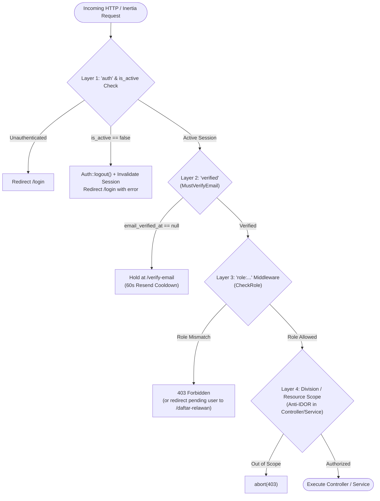
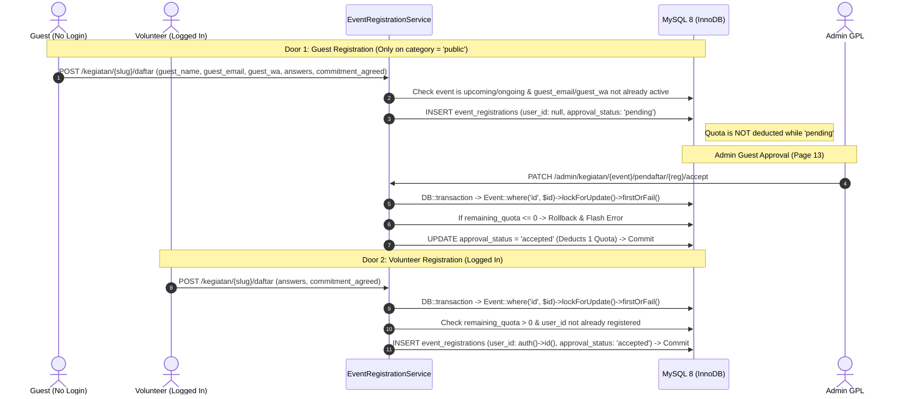

# AGENTS.md — Master Technical, Contract & Security Guide for GPL Yuk!

> **MANDATORY FOR ALL DEVELOPERS (`RD`, `AS`, `FN`, `C`) & AI ASSISTANTS (Antigravity, Cursor, Claude Code, Copilot, Windsurf):**
> Read this file before writing or modifying any code in this repository. It is the **Single Source of Truth** that locks Database Schemas, Ziggy Route Names, Inertia Props JSON Shapes, Form Field Payloads, and Pentest Security Rules so Backend and Frontend integrate with zero conflicts.

---

## 1. Core Architecture & Stack Rules (Non-Negotiable)

- **Framework:** Laravel 12 Monolith + Inertia.js v2 (React 18 `.jsx`) + Ziggy (`route()`) + Tailwind CSS v3 + Vite 7.
- **Database:** MySQL 8 (InnoDB required for `lockForUpdate()` row-level locking).
- **Storage:** Cloudflare R2 (via S3 driver) with automatic local disk fallback during local development.
- **Timezone:** `Asia/Jakarta` (WIB / UTC+7) — already configured in `config/app.php`. All date/time comparisons (`now()`, `CURDATE()`) operate in WIB.
- **NO Decoupled REST API (`/api/v1`):**
  - Do **NOT** build Sanctum Bearer Token APIs or `/api/v1/...` routes.
  - All routes live in `routes/web.php` (and `routes/auth.php`) using Laravel session authentication and `Inertia::render('...', $props)`.
  - **Only 4 interactive endpoints return JSON directly** (to avoid full page reload):
    1. `POST /portal/presensi/toggle` (`attendance.toggle` — Attendance checkbox toggle)
    2. `GET /admin/rekrutmen/{application}/cv-url` (`admin.recruitment.cv-url` — 15-min pre-signed R2 URL)
    3. `GET /admin/transaksi/{donation}/proof-url` (`admin.transactions.proof-url` — 15-min pre-signed R2 URL, Phase 2)
    4. `POST /notifications/{id}/read` (`notifications.read` — Mark pop-up modal notification read, Phase 3)

---

## 2. Coding Philosophy (Ponytail — Lean & Anti-Overengineering)

1. **No Unrequested Abstractions:** Do not create Repository classes, Interfaces with a single implementation, DTOs, or unnecessary wrapper layers.
2. **Keep It Simple:**
   - **Validation:** Use Laravel `FormRequest` classes (`app/Http/Requests/...`).
   - **Controllers:** Keep controllers thin (`Inertia::render` or `redirect()->back()->with('success', '...')`).
   - **Services:** Only create a Service class when there is multi-step transactional/concurrency logic (`EventRegistrationService`, `AttendanceService`, `EventReportExportService`).
3. **Database Migrations Are Already Aligned:**
   - All MVP & Phase 2 schema updates are **already migrated** in `database/migrations/2026_11_18_000000_align_mvp_and_phase2_schema.php`.
   - **DO NOT create duplicate migrations** for `org_members`, `volunteer_applications`, or the new columns on `events`, `event_registrations`, `attendances`, and `articles`.
   - Run `php artisan migrate:fresh --seed` to get the full schema and seeded test accounts.

---

## 3. Database Schema & Critical RBAC Gotchas

### 3.1 Seeded Roles (`roles.slug`) & Test Accounts (Password: `password123`)
| Role Slug | Seeded Email | Redirect After Login | Access Scope |
| :--- | :--- | :--- | :--- |
| `admin` | `admin@gplyuk.com` | `/admin/kegiatan` | Full access to `/admin/*` & `/portal/presensi` |
| `ketua` | `ketua@gplyuk.com` | `/portal/presensi` | Manager DPI — sees **ALL divisions** in attendance portal |
| `sekretaris` | `sekretaris@gplyuk.com` | `/portal/presensi` | Manager DPI — manages *Divisi Acara* & *Divisi Humas* |
| `bendahara` | `bendahara@gplyuk.com` | `/portal/presensi` | Manager DPI — manages *Divisi Logistik* |
| `volunteer` | `volunteer@gplyuk.com` | `/dashboard/relawan` | Official volunteer (assigned to 1 division via `users.division_id`) |
| `pending` | `pending@gplyuk.com` | `/daftar-relawan` | Newly registered account (must verify email first, then upload CV) |

### 3.2 CRITICAL GOTCHA: How Divisions Relate to Volunteers vs Managers
- **Volunteers (`role: volunteer`):** Belong to **1 division** stored in `users.division_id`.
- **Managers (`role: sekretaris | bendahara`):** Have `users.division_id = null`! Instead, the divisions they supervise are linked via **`divisions.manager_id`** (`$user->managedDivisions()`).
- **Mandatory Query Rule for `GPL-97` (Portal Presensi Manager):**
  - Use `$user->canManageAllDivisions()` (already on `App\Models\User`) to check if user is `admin` or `ketua`.
  - If `canManageAllDivisions()` is `false` (`sekretaris` or `bendahara`), filter the volunteer roster using:
    ```php
    $managedDivisionIds = $user->managedDivisions()->pluck('id');
    $query->whereIn('users.division_id', $managedDivisionIds);
    ```

### 3.3 Exact Table Columns Reference
- **`users`**: `id, name, email, password, phone_number (628...), role_id, division_id (nullable), position, is_active (bool), email_verified_at, timestamps`
- **`divisions`**: `id, name, slug (acara|logistik|operasional|humas), manager_id (FK users.id), timestamps`
- **`events`**: `id, title, slug, description, location, location_type (physical|virtual), category (public|internal), start_at, end_at, quota, price (decimal 10,2), banner_url, is_featured (bool, max 2 active), form_schema (json array), status (upcoming|ongoing|completed|cancelled), created_by_id, timestamps`
- **`event_registrations`**: `id, user_id (nullable for guest), event_id, guest_name, guest_email, guest_wa, status (registered|waitlisted|cancelled), approval_status (pending|accepted|rejected), commitment_agreed (bool), answers (json), notes, created_at, cancelled_at`
- **`attendances`**: `id, registration_id (unique), recorded_by_id, check_in_time, revoked_at (nullable), revoked_by_id (nullable), created_at`
- **`volunteer_applications`**: `id, user_id, division_choice_id, cv_path, cv_original_name, extra_fields (json), status (pending|approved|rejected), admin_note, timestamps`
- **`org_members`**: `id, name, position, division, period (e.g. '2026/2027'), photo_url, social_links (json), sort_order (int), timestamps`
- **`articles`**: `id, title, slug, content (HTML), cover_url, pdf_url (nullable), author_id, status (draft|published), published_at, timestamps`
- **`event_photos`**: `id, event_id, image_url, caption, sort_order, created_at`
- **`donations`**: `id, trx_code (unique), user_id (nullable), event_id (nullable), type (donation|event_ticket), donor_name, donor_email, donor_wa, is_anonymous (bool), amount (decimal 12,2), message, proof_url, status (pending|verified|rejected), admin_note (nullable), verified_by_id, verified_at, created_at`
- **`badges`** & **`user_badges`**: `badges (id, name, description, image_url, min_attendance, reward_points, is_active, created_at)` & `user_badges (id, user_id, badge_id, awarded_by_id [nullable for auto], note, awarded_at)`

---

## 4. Global Shared Inertia Props (`HandleInertiaRequests.php`)

Every Inertia page automatically receives these global props in `usePage().props`:

```json
{
  "auth": {
    "user": {
      "id": 1,
      "name": "Volunteer Fulan",
      "email": "volunteer@gplyuk.com",
      "phone_number": "6289876543210",
      "position": "Anggota Divisi Acara",
      "is_active": true,
      "email_verified_at": "2026-11-18T08:00:00.000000Z",
      "role": { "id": 5, "name": "Volunteer", "slug": "volunteer" },
      "division": { "id": 1, "name": "Divisi Acara", "slug": "acara" }
    }
  },
  "flash": {
    "success": "Pesan sukses dari session flash (atau null)",
    "error": "Pesan error dari session flash (atau null)"
  }
}
```

---

## 5. Canonical Routes, Ziggy Names & Inertia Component Map (BE ↔ FE Contract)

Backend (`RD`, `AS`) and Frontend (`FN`, `C`) **MUST** use these exact URIs, Ziggy Route Names (`->name('...')`), and Inertia Page paths:

### 5.1 Public Routes (Sprint 1 & Sprint 2)
| Method & URI | Ziggy Route Name | Inertia Component (`resources/js/Pages/...`) | Props Contract Sent by Backend | Jira |
| :--- | :--- | :--- | :--- | :-: |
| `GET /` | `home` | `Public/Landing.jsx` | `{ featuredEvents: Event[], upcomingEvents: Event[], impactStats: { total_volunteers, total_events, total_trees } }` | `GPL-91, 110, 107` |
| `GET /tentang-kami` | `about` | `Public/AboutUs.jsx` | `{}` (Static content) | `GPL-78, 95` |
| `GET /struktur-organisasi` | `org-structure.index` | `Public/OrgStructure.jsx` | `{ availablePeriods: string[], currentPeriod: string, members: { dpi: OrgMember[], divisions: Record<string, OrgMember[]> } }` | `GPL-68, 114, 119` |
| `GET /kegiatan` | `events.index` | `Public/EventsCatalog.jsx` | `{ events: Paginated<Event>, filters: { search, category, status } }` | `GPL-86, 92, 107` |
| `GET /kegiatan/{event:slug}` | `events.show` | `Public/EventDetail.jsx` | `{ event: Event (with remaining_quota, computed_status, form_schema), isRegistered: bool }` | `GPL-102, 108, 121` |
| `POST /kegiatan/{event:slug}/daftar` | `events.register` | *(Redirect back with flash)* | Validates `RegisterEventRequest` | `GPL-108, 121` |
| `GET /artikel` | `articles.index` | `Public/ArticlesIndex.jsx` | `{ articles: Paginated<Article>, filters: { search } }` | `GPL-112` |
| `GET /artikel/{article:slug}` | `articles.show` | `Public/ArticleDetail.jsx` | `{ article: Article (with pdf_url, author), relatedArticles: Article[] }` | `GPL-103, 112, 118` |
| `GET /galeri` | `gallery.index` | `Public/Gallery.jsx` | `{ galleries: Array<{ year: number, events: Array<{ title: string, photos: EventPhoto[] }> }> }` | `GPL-126, 127` |
| `POST /donasi` | `donations.store` | *(Redirect back with flash)* | Validates `StoreDonationRequest` (Phase 2) | `GPL-129, 131` |

### 5.2 Auth, Calon Relawan & Volunteer Routes (Sprint 1)
| Method & URI | Ziggy Route Name | Middleware | Inertia Component | Props / Behavior | Jira |
| :--- | :--- | :--- | :--- | :--- | :-: |
| `GET /register` | `register` | `guest` | `Auth/Register.jsx` | Registration view | `GPL-53, 120` |
| `POST /register` | `register.store` | `guest` | *(Redirect to `/verify-email`)* | Normalizes WA to `628...`, sets role `pending`, queues verification email | `GPL-53, 120` |
| `GET /verify-email` | `verification.notice` | `auth` | `Auth/VerifyEmail.jsx` | `{ status: session('status') }` | `GPL-53, 120` |
| `POST /email/verification-notification` | `verification.send` | `auth, throttle:3,60` | *(Redirect back)* | 60s cooldown on resend | `GPL-53, 120` |
| `GET /login` | `login` | `guest` | `Auth/Login.jsx` | `{ canResetPassword: bool, status: string }` | `GPL-96, 120` |
| `POST /login` | `login.store` | `guest, throttle:5,1` | *(Role-based Redirect)* | Blocks `is_active = false`, redirects by role | `GPL-96, 67, 120` |
| `GET /daftar-relawan` | `volunteer.apply` | `auth, verified, role:pending` | `Volunteer/ApplicationForm.jsx` | `{ divisions: Division[], latestApplication: { id, status, division_choice_id, cv_original_name, admin_note, created_at } \| null }` | `GPL-70, 115, 122` |
| `POST /daftar-relawan` | `volunteer.apply.store` | `auth, verified, role:pending` | *(Redirect back with flash)* | Uploads CV (`pdf,jpg,png <= 3MB`) to private R2 (`cvs/applications/{uuid}`) | `GPL-70, 122` |
| `GET /dashboard/relawan` | `volunteer.dashboard` | `auth, verified, role:volunteer` | `Volunteer/Dashboard.jsx` | `{ profile: User, registrations: Array<{ id, event: Event, approval_status, display_status: 'registered'\|'attended'\|'cancelled', check_in_time: string\|null }>, badges: Badge[], unreadNotifications: Notification[] }` | `GPL-81, 93, 109` |

### 5.3 Manager / DPI Attendance Portal Routes (Sprint 1)
| Method & URI | Ziggy Route Name | Middleware | Component / Response | Exact Props / JSON Shape | Jira |
| :--- | :--- | :--- | :--- | :--- | :-: |
| `GET /portal/presensi` | `attendance.portal` | `auth, verified, role:admin,ketua,sekretaris,bendahara` | `Manager/AttendancePortal.jsx` | `{ events: Event[], selectedEvent: Event\|null, isTodayActive: bool, summary: { total_registered: int, total_attended: int }, volunteerRoster: Array<{ registration_id, name, phone_number, division_name, is_present: bool, check_in_time: string\|null }>, guestRoster: Array<{ registration_id, name, phone_number, email, is_present: bool, check_in_time: string\|null }> }` | `GPL-82, 94, 97` |
| `POST /portal/presensi/toggle` | `attendance.toggle` | `auth, verified, role:admin,ketua,sekretaris,bendahara` | **JSON Response** | Request: `{ registration_id: int, present: bool }`<br/>Response: `{ success: true, registration_id: int, is_present: bool, check_in_time: string\|null, summary: { total_registered: int, total_attended: int } }` | `GPL-97, 94` |

### 5.4 Admin Dashboard Routes (`middleware: ['auth', 'verified', 'role:admin']`)
| Method & URI | Ziggy Route Name | Component / Response | Exact Props / Behavior | Jira |
| :--- | :--- | :--- | :--- | :-: |
| `GET /admin/kegiatan` | `admin.events.index` | `Admin/Events/Index.jsx` | `{ events: Paginated<Event> (with remaining_quota, registrations_count), filters: { status, search } }` | `GPL-100, 105, 123` |
| `POST /admin/kegiatan` | `admin.events.store` | *(Redirect back with flash)* | Validates `StoreEventRequest` (max 2 `is_featured`, `form_schema`) | `GPL-105, 123` |
| `PUT /admin/kegiatan/{event}` | `admin.events.update` | *(Redirect back with flash)* | Validates `UpdateEventRequest` | `GPL-105, 123` |
| `DELETE /admin/kegiatan/{event}` | `admin.events.destroy` | *(Redirect back with flash)* | If `registrations()->count() > 0`, block delete & set `status = 'cancelled'` | `GPL-105, 123` |
| `GET /admin/kegiatan/{event}/pendaftar` | `admin.events.registrants` | `Admin/Events/Registrants.jsx` | `{ event: Event, guestRegistrants: Array<{ id, guest_name, guest_email, guest_wa, answers, approval_status, display_status, check_in_time, whatsapp_url }>, volunteerRegistrants: Array<{ id, user: User, answers, display_status, check_in_time }> }` | `GPL-106, 123` |
| `PATCH /admin/kegiatan/{event}/pendaftar/{registration}/accept` | `admin.events.registrants.accept` | *(Redirect back with flash)* | Runs `lockForUpdate()` to check quota before `approval_status = 'accepted'` | `GPL-106, 123` |
| `PATCH /admin/kegiatan/{event}/pendaftar/{registration}/reject` | `admin.events.registrants.reject` | *(Redirect back with flash)* | Sets `approval_status = 'rejected'` | `GPL-106, 123` |
| `GET /admin/kegiatan/{event}/export` | `admin.events.export` | **File Stream Download** | Query: `?format=xlsx` or `?format=csv` (10 official columns) | `GPL-98, 123` |
| `GET /admin/rekrutmen` | `admin.recruitment.index` | `Admin/Recruitment/Index.jsx` | `{ applications: Paginated<VolunteerApplication> (with user, divisionChoice), divisions: Division[], filters: { status, division_id } }` | `GPL-71, 116, 124` |
| `GET /admin/rekrutmen/{application}/cv-url` | `admin.recruitment.cv-url` | **JSON Response** | `{ url: "https://..." }` (15-min R2 pre-signed URL) | `GPL-71, 124` |
| `PATCH /admin/rekrutmen/{application}/decision` | `admin.recruitment.decision` | *(Redirect back with flash)* | Request: `{ decision: 'approve'\|'reject', admin_note: string\|null }` | `GPL-71, 124` |
| `GET /admin/cms/org-members` | `admin.org-members.index` | `Admin/Cms/OrgMembers.jsx` | `{ members: Paginated<OrgMember>, availablePeriods: string[], filters: { period } }` | `GPL-68, 113, 125` |
| `POST /admin/cms/org-members` | `admin.org-members.store` | *(Redirect back with flash)* | Uploads `photo_file` (`<= 3MB`) to `org_photos/` | `GPL-68, 125` |
| `PUT /admin/cms/org-members/{orgMember}` | `admin.org-members.update` | *(Redirect back with flash)* | Updates org member | `GPL-68, 125` |
| `DELETE /admin/cms/org-members/{orgMember}` | `admin.org-members.destroy` | *(Redirect back with flash)* | Deletes org member & photo | `GPL-68, 125` |
| `GET /admin/cms/articles` | `admin.articles.index` | `Admin/Cms/Articles.jsx` | `{ articles: Paginated<Article>, filters: { status, search } }` | `GPL-112, 113, 125` |
| `POST /admin/cms/articles` | `admin.articles.store` | *(Redirect back with flash)* | Uploads `cover_file` (`<= 3MB`) & optional `pdf_file` (`<= 5MB`) | `GPL-112, 125` |
| `PUT /admin/cms/articles/{article}` | `admin.articles.update` | *(Redirect back with flash)* | Updates article + sanitizes HTML | `GPL-112, 125` |
| `DELETE /admin/cms/articles/{article}` | `admin.articles.destroy` | *(Redirect back with flash)* | Deletes article | `GPL-112, 125` |
| `GET /admin/users` | `admin.users.index` | `Admin/Users/Index.jsx` | `{ users: Paginated<User> (with role, division, managedDivisions), divisions: Division[], roles: Role[], filters: { role, search } }` | `GPL-111, 117, 125` |
| `POST /admin/users/managers` | `admin.users.managers.store` | *(Redirect back with flash)* | Creates Manager & sets `divisions.manager_id` | `GPL-111, 125` |
| `PATCH /admin/users/{user}/toggle-active` | `admin.users.toggle-active` | *(Redirect back with flash)* | Toggles `is_active`; if `false`, deletes rows in `sessions` for that user | `GPL-111, 125` |
| `GET /admin/transaksi` | `admin.transactions.index` | `Admin/Transactions/Index.jsx` | Phase 2: `{ transactions: Paginated<Donation>, summary: { total_verified, total_pending } }` | `GPL-128, 130, 131` |
| `PATCH /admin/transaksi/{donation}/verify` | `admin.transactions.verify` | *(Redirect back with flash)* | Phase 2: Request `{ status: 'verified'\|'rejected', admin_note }` | `GPL-130, 131` |
| `GET /admin/transaksi/export` | `admin.transactions.export` | **File Stream Download** | Phase 2: `?format=xlsx` or `?format=csv` | `GPL-130, 131` |
| `GET /admin/gamifikasi` | `admin.gamification.index` | `Admin/Gamification/Index.jsx` | Phase 3: `{ badges: Badge[], growthChart: any[], attendanceChart: any[], leaderboard: User[] }` | `GPL-132..136` |

---

## 6. Exact Form Field Payload Names (`useForm` React ↔ `FormRequest` Laravel)

To prevent `422 Unprocessable Entity` mismatches between Frontend and Backend, use these exact field keys:

1. **Register (`POST /register`):**
   `{ name, email, phone_number, password, password_confirmation }`
2. **Event Registration (`POST /kegiatan/{event:slug}/daftar`):**
   - Guest: `{ guest_name, guest_email, guest_wa, commitment_agreed: true, answers: { [question_id]: value } }`
   - Volunteer (Logged in): `{ commitment_agreed: true, answers: { [question_id]: value } }`
3. **Volunteer CV Application (`POST /daftar-relawan`):**
   `{ division_choice_id, cv_file, extra_fields: {} }` (multipart/form-data)
4. **Admin Event Create/Update (`POST /admin/kegiatan`):**
   `{ title, description, location, location_type: 'physical'|'virtual', category: 'public'|'internal', start_at, end_at, quota, price, banner_file, is_featured: bool, form_schema: Array<{ id, label, type: 'text'|'textarea'|'select', required: bool, options?: string[] }> }`
5. **Admin Recruitment Decision (`PATCH /admin/rekrutmen/{application}/decision`):**
   `{ decision: 'approve'|'reject', admin_note: string|null }`
6. **Admin Org Member Create/Update (`POST /admin/cms/org-members`):**
   `{ name, position, division, period, photo_file, social_links: { instagram?: string, linkedin?: string }, sort_order: int }`
7. **Admin Article Create/Update (`POST /admin/cms/articles`):**
   `{ title, content, cover_file, pdf_file, status: 'draft'|'published' }`
8. **Admin Create Manager (`POST /admin/users/managers`):**
   `{ name, email, phone_number, password, role_slug: 'ketua'|'sekretaris'|'bendahara', division_ids: int[] }`

---

## 7. Security & Pentest Hardening Rules (Mandatory for All Backend Code)

Every Backend ticket is pentested immediately upon completion. Follow these **6 Security Pillars**:

1. **Authentication, Rate Limiting & Session Kill-Switch (`GPL-53, 96, 111`):**
   - Password rule: `Password::min(8)->mixedCase()->numbers()->symbols()`.
   - Rate Limiters: Login `5/min` per IP+email (`429`); Register `10/hr` per IP; Verification resend `60s cooldown` (`3/hr`); Forgot password `3/hr` per email (token expires in `60 mins`).
   - Generic auth error messages (prevent user enumeration).
   - **Session Kill-Switch:** When a user resets their password OR Admin sets `is_active = false`, immediately run:
     ```php
     DB::table('sessions')->where('user_id', $user->id)->delete();
     ```

2. **Strict RBAC & Anti-IDOR Enforcement (`GPL-67, 71, 97`):**
   - Never read `user_id` or `recorded_by_id` from `$request->input()`; always use `auth()->id()`.
   - **Anti-IDOR in `POST /portal/presensi/toggle` (`GPL-97`):**
     Before toggling attendance for a volunteer registration (`$registration->user_id !== null`), verify that the logged-in Manager has authority over that volunteer's division:
     ```php
     if ($registration->user_id && !$manager->canManageDivision($registration->user->division_id)) {
         abort(403, 'Anda tidak memiliki akses untuk mengabsen relawan dari divisi lain.');
     }
     ```
   - **Anti-IDOR in `GET /admin/rekrutmen/{application}/cv-url` (`GPL-71`):**
     Allow only if `auth()->user()->hasRole('admin')` or `auth()->id() === $application->user_id`; otherwise `abort(403)`.

3. **File Upload Hardening & Storage Fallback (`GPL-70, 71, 105, 112, 129`):**
   - Validate real MIME types via PHP FileInfo (`mimes:pdf,jpg,png,webp`) and strict file sizes (`max:3072` for 3 MB; `max:5120` for 5 MB PDF Paper).
   - **Never use original client filenames for storage.** Always generate a UUID filename:
     ```php
     $filename = Str::uuid() . '.' . $file->extension();
     ```
   - **Storage Disk Convention (Local Dev Fallback vs Production Cloudflare R2):**
     - **Public Assets** (`banners/`, `org_photos/`, `articles/covers/`, `articles/pdfs/`, `galleries/`, `badges/`): Store on `config('filesystems.default_public_disk', 'public')` (uses `'s3'` in production R2, `'public'` locally).
     - **Private Sensitive Documents** (`cvs/applications/`, `proofs/`): Store on private disk (`'s3'` private bucket in production, `'local'` `storage/app/private` locally). In production R2, generate a 15-minute Pre-Signed URL (`Storage::disk('s3')->temporaryUrl($path, now()->addMinutes(15))`); in local dev fallback, return a signed route stream.

4. **Anti-Injection: SQLi, Stored XSS & CSV Formula Injection (`GPL-98, 107, 112`):**
   - **SQLi:** Use Eloquent / parameterized bindings only. Whitelist all filter query params (`in:upcoming,ongoing,completed`, `in:all,public,internal`).
   - **Stored XSS (`GPL-112`):** Sanitize `articles.content` HTML before saving (strip `<script>`, `<iframe>`, `<object>`, `<embed>`, `on*` event attributes, and `javascript:` URLs).
   - **CSV / Excel Formula Injection (`GPL-98`):** In `EventReportExportService`, sanitize every string cell before writing to `.xlsx` or `.csv`: if a value starts with `=`, `+`, `-`, or `@`, prepend a single quote `'` (e.g. `'=cmd|...`) so Excel never executes it as a formula.

5. **Concurrency & Audit Integrity (`GPL-97, 106, 108`):**
   - **Anti-Overbooking (`lockForUpdate`):** Wrap volunteer registration (`GPL-108`) and admin guest approval (`GPL-106`) inside `DB::transaction()` and lock the event row first (`Event::where('id', $event->id)->lockForUpdate()->firstOrFail()`).
   - **Remaining Quota Formula:**
     ```php
     $remainingQuota = $event->quota - $event->registrations()
         ->where('approval_status', 'accepted')
         ->where('status', '!=', 'cancelled')
         ->count();
     ```
   - **Zero Physical Delete on Attendance (`GPL-97`):** Never call `$attendance->delete()`. Unchecking sets `revoked_at = now()` and `revoked_by_id = auth()->id()`. Active attendance = `whereNull('revoked_at')`.
   - **Full-Day Hari-H Time Guard (`GPL-97`):** Attendance mutations are allowed only when `now()->toDateString()` (WIB) is between `$event->start_at->toDateString()` and `$event->end_at->toDateString()`. Outside this window, abort with `422`.

6. **10 Official Columns for Event Report Export (`GPL-98`):**
   Export in this exact column order:
   1. `No Tiket Registrasi`
   2. `Nama Lengkap` (`user.name` or `guest_name`)
   3. `Tipe Peserta` (`Relawan Internal` or `Partisipan Publik`)
   4. `Divisi / Asal Instansi` (`user.division.name` or guest answer)
   5. `Nomor WhatsApp` (`628...`)
   6. `Email` (`user.email` or `guest_email`)
   7. `Jawaban Form Kustom` (Flattened key-value string from `answers` JSON)
   8. `Status Seleksi` (`Accepted` / `Pending` / `Rejected`)
   9. `Status Kehadiran Lapangan` (`Attended` if active attendance exists where `revoked_at IS NULL`, else `Registered`)
   10. `Waktu Check-In Presensi` (`check_in_time` formatted in WIB, or `-`)

---

## 8. System Design & Reference Implementation Blueprints

### 8.1 Authentication & Authorization System Design (`GPL-53, 67, 96, 111`)

#### A. Stateful Session Architecture (`SESSION_DRIVER=database`)
- Uses **HTTP-Only Encrypted Session Cookies** backed by the `sessions` table in MySQL (`user_id` indexed) + automatic `XSRF-TOKEN` CSRF protection.
- **No `localStorage` tokens:** Immune to XSS token theft and allows instant server-side session revocation (`DB::table('sessions')->where('user_id', $id)->delete()`).

#### B. 4-Layer Gatekeeper Flow


#### C. Reference Implementation Contracts for Auth & RBAC
1. **`App\Models\User` (`implements MustVerifyEmail` & `dashboardRoute()`):**
   ```php
   use Illuminate\Contracts\Auth\MustVerifyEmail;

   class User extends Authenticatable implements MustVerifyEmail
   {
       public function dashboardRoute(): string
       {
           if (! $this->hasVerifiedEmail()) {
               return route('verification.notice', absolute: false);
           }

           return match ($this->role?->slug) {
               'admin' => route('admin.events.index', absolute: false),
               'ketua', 'sekretaris', 'bendahara' => route('attendance.portal', absolute: false),
               'volunteer' => route('volunteer.dashboard', absolute: false),
               default => route('volunteer.apply', absolute: false),
           };
       }
   }
   ```
2. **`App\Http\Middleware\CheckRole` (Register alias `'role' => CheckRole::class` in `bootstrap/app.php`):**
   ```php
   public function handle(Request $request, Closure $next, string ...$roles): Response
   {
       $user = $request->user();

       if (! $user) {
           return redirect()->route('login');
       }

       if (! $user->is_active) {
           Auth::guard('web')->logout();
           $request->session()->invalidate();
           $request->session()->regenerateToken();
           return redirect()->route('login')->withErrors(['email' => 'Akun Anda telah dinonaktifkan oleh Administrator.']);
       }

       if (! $user->hasRole($roles)) {
           if ($user->hasRole('pending')) {
               return redirect()->route('volunteer.apply');
           }
           abort(403, 'Anda tidak memiliki hak akses ke halaman ini.');
       }

       return $next($request);
   }
   ```
3. **`App\Http\Middleware\HandleInertiaRequests` (Eager-load `role`, `division`, and share `flash`):**
   ```php
   public function share(Request $request): array
   {
       return [
           ...parent::share($request),
           'auth' => [
               'user' => $request->user()?->loadMissing(['role:id,name,slug', 'division:id,name,slug']),
           ],
           'flash' => [
               'success' => fn () => $request->session()->get('success'),
               'error' => fn () => $request->session()->get('error'),
           ],
       ];
   }
   ```
4. **`App\Http\Requests\Auth\LoginRequest` (Check `is_active` right after `Auth::attempt`):**
   ```php
   if (! Auth::user()->is_active) {
       Auth::guard('web')->logout();
       throw ValidationException::withMessages([
           'email' => 'Akun Anda telah dinonaktifkan oleh Administrator.',
       ]);
   }
   ```

---

### 8.2 Dual-Door Event Registration & Quota Concurrency Design (`GPL-105..108`)



---

### 8.3 Field Attendance Portal & Auto-Badge Evaluation Design (`GPL-97, 133`)

1. **Default Event Selection (`GET /portal/presensi`):**
   - Query active event today first: `WHERE DATE(start_at) <= CURDATE() AND DATE(end_at) >= CURDATE() AND status != 'cancelled'`.
   - If none exists today, fallback to latest completed event (`ORDER BY end_at DESC LIMIT 1`) and set `isTodayActive = false` (Read-Only History Mode).
2. **Roster Partitioning:**
   - **Tab 1 (`volunteerRoster`):** `event_registrations` where `user_id IS NOT NULL` and `status = 'registered'`. If `!$manager->canManageAllDivisions()`, filter `whereHas('user', fn ($q) => $q->whereIn('division_id', $manager->managedDivisions()->pluck('id')))`.
   - **Tab 2 (`guestRoster`):** `event_registrations` where `user_id IS NULL`, `status = 'registered'`, and `approval_status = 'accepted'`.
3. **Idempotent Toggle & Audit Trail (`POST /portal/presensi/toggle`):**
   - Verify `isTodayActive` (`now()->toDateString()` between `start_at` and `end_at` dates in WIB); otherwise `abort(422)`.
   - Verify division authorization if `$registration->user_id !== null` (`!$manager->canManageDivision($registration->user->division_id)` ➔ `abort(403)`).
   - If `present === true`: `Attendance::updateOrCreate(['registration_id' => $reg->id], ['recorded_by_id' => auth()->id(), 'check_in_time' => now(), 'revoked_at' => null, 'revoked_by_id' => null])`.
   - If `present === false`: `Attendance::where('registration_id', $reg->id)->update(['revoked_at' => now(), 'revoked_by_id' => auth()->id()])`.
   - Return updated `{ success: true, registration_id, is_present, check_in_time, summary: { total_registered, total_attended } }`.

---

### 8.4 Cloudflare R2 & Local Fallback Storage Design (`GPL-70, 71, 105, 112, 129, 130`)

- **Folder Structure:**
  - **Public Disk (`public` locally / `s3` public bucket in prod):**
    - `banners/{uuid}.{ext}` (Event posters `<= 3MB`)
    - `org_photos/{uuid}.{ext}` (Org member photos `<= 3MB`)
    - `articles/covers/{uuid}.{ext}` (Article covers `<= 3MB`)
    - `articles/pdfs/{uuid}.pdf` (Article PDF papers `<= 5MB`)
    - `galleries/{uuid}.{ext}` (Past event photos `<= 3MB`)
    - `badges/{uuid}.{ext}` (Gamification badge icons `<= 3MB`)
  - **Private Disk (`local` `storage/app/private` locally / `s3` private bucket in prod):**
    - `cvs/applications/{uuid}.{ext}` (Volunteer CVs `<= 3MB`)
    - `proofs/{uuid}.{ext}` (Donation & paid ticket transfer proofs `<= 3MB`)
- **Pre-Signed URL Helper Pattern (`GPL-71` & `GPL-130`):**
  ```php
  // Inside Admin Recruitment / Transaction Controller after Policy check:
  $disk = config('filesystems.private_disk', 'local');
  $url = $disk === 's3'
      ? Storage::disk('s3')->temporaryUrl($application->cv_path, now()->addMinutes(15))
      : URL::temporarySignedRoute('admin.recruitment.cv-stream', now()->addMinutes(15), ['application' => $application->id]);

  return response()->json(['url' => $url]);
  ```

---

## 9. Frontend Design Tokens & Shared Layouts Contract (`GPL-74, GPL-76`)

To ensure **Fawwaz (`FN`)** and **Cliff (`C`)** produce visually identical React components, all Frontend code MUST use these Tailwind tokens and layout wrappers:

1. **Tailwind Color & Typography Tokens (`tailwind.config.js`):**
   - **Primary Forest Green:** `gpl-forest` (`#1B4D3E`), `gpl-forest-dark` (`#12352B`), `gpl-forest-light` (`#2A6F58`)
   - **Secondary / Leaf Green:** `gpl-leaf` (`#4E9F6E`), `gpl-mint` (`#E8F5E9`)
   - **Accent Warm Gold:** `gpl-gold` (`#DDA74F`), `gpl-gold-light` (`#F5E6C8`)
   - **Neutral Background:** `gpl-cream` (`#FAF8F5`)
   - **Font Families:**
     - `font-heading`: `['"Lazy Dog"', '"Fredoka"', 'cursive', 'sans-serif']` (Page titles & section headings)
     - `font-sans`: `['"Fredoka"', '"Plus Jakarta Sans"', 'sans-serif']` (Body text, forms, tables)

2. **Canonical Layout Wrappers (`resources/js/Layouts/...`):**
   - **`Layouts/PublicLayout.jsx`:** Used by all `Public/*` pages (`Landing`, `AboutUs`, `OrgStructure`, `EventsCatalog`, `EventDetail`, `ArticlesIndex`, `ArticleDetail`, `Gallery`). Contains sticky Navbar (auto-switches `Login/Daftar Relawan` vs `Dashboard/Logout` based on `usePage().props.auth.user`) and GPL Footer.
   - **`Layouts/DashboardLayout.jsx`:** Used by `Volunteer/*`, `Manager/*`, and `Admin/*` pages. Renders role-aware navigation items based on `auth.user.role.slug` and a global flash notification banner (`usePage().props.flash`).

---

## 10. Developer Ticket Ownership & Git Workflow Cheat Sheet

When a developer prompts their AI assistant *"Kerjakan tiket GPL-XXX"*, follow the exact assignment and scope below:

### 10.1 Backend Developers (`RD` & `AS`)
- **Rafy Dhia (`RD` — Branch: `feature-dhia`):**
  - `GPL-96`: Login (`is_active` check), Reset Password (60m + session kill-switch), Rate Limiting (`5/min`).
  - `GPL-53`: Register (`628...` WA normalization, strong password, role `pending`), Email Verification Gate (60s cooldown).
  - `GPL-67`: `CheckRole` middleware (`role:...`), `User::dashboardRoute()` role-based login redirect, `HandleInertiaRequests` shared auth/flash props.
  - `GPL-97`: Manager Field Attendance Portal (`/portal/presensi` & `/portal/presensi/toggle`), `managedDivisions()` RBAC filter, Full-Day Hari-H WIB guard, idempotent toggle (`revoked_at`).
  - `GPL-109`: Volunteer Dashboard data (`/dashboard/relawan` profile, event history with `display_status`, profile update).
  - `GPL-70`: Volunteer CV Application (`GET/POST /daftar-relawan`, State A/B/C, UUID upload to private R2, re-apply on `rejected`).
  - `GPL-71`: Admin Recruitment Decision (`/admin/rekrutmen`, 15-min Pre-Signed CV URL, atomic Approve role promotion to `volunteer`).
  - `GPL-111`: Admin Account Management (`/admin/users`, create Manager & assign `divisions.manager_id`, toggle `is_active` + session kill-switch).
  - `GPL-130` (Sprint 2) & `GPL-133` (Sprint 3): Admin Transaction Verification & Master Badge Auto-Evaluation.

- **Aaron Faustine Suryanto (`AS` — Branch: `feature-aaron`):**
  - `GPL-105`: Admin Event CRUD (`/admin/kegiatan`), Banner upload, max 2 `is_featured`, `form_schema` (`text, textarea, select`), cancel-instead-of-delete guard.
  - `GPL-107`: Public Landing & Events Catalog (`/`, `/kegiatan`), `remaining_quota` (`accepted` only) & `computed_status` (WIB), search & filters.
  - `GPL-108`: Dual-Door Event Registration (`POST /kegiatan/{event:slug}/daftar`), Guest (`pending`, no quota cut) vs Volunteer (`accepted`, cuts quota with `lockForUpdate()`).
  - `GPL-106`: Admin Registrant Management (`/admin/kegiatan/{event}/pendaftar`), Guest Accept (with `lockForUpdate()`) / Reject, `whatsapp_url` helper.
  - `GPL-98`: Event Report Export (`/admin/kegiatan/{event}/export?format=xlsx|csv`), 10 official columns + CSV formula injection sanitization.
  - `GPL-68`: Dynamic Organization Structure (`/struktur-organisasi` & `/admin/cms/org-members`).
  - `GPL-112` & `GPL-126` & `GPL-129` (Sprint 2), `GPL-135` (Sprint 3): Articles/Papers CRUD + PDF, Gallery, Donation store, Analytics/Leaderboard.

### 10.2 Frontend Developers (`FN` & `C`)
- **Fawwaz (`FN` — Branch: `feature-fawwaz`):**
  - `GPL-74` (Design Tokens), `GPL-76` (Global Components & Layouts), `GPL-91` (Landing Page), `GPL-120` (Auth Pages 07–09), `GPL-121` (Event Detail & Dual-Door Form), `GPL-94` (Manager Attendance Portal), `GPL-122` (Volunteer CV Form State A/B/C), `GPL-123..125` (Admin Dashboard Pages), `GPL-131` (Donations FE), `GPL-136` (Admin Gamification FE).
- **Cliff (`C` — Branch: `feature-cliff`):**
  - `GPL-110` (Landing Featured Events), `GPL-95` (About Us), `GPL-92` (Events & Articles Catalog), `GPL-93` (Volunteer Dashboard), `GPL-118` (Article Detail & PDF Viewer), `GPL-119` (Public Org Structure), `GPL-127` (Gallery Lightbox), `GPL-134` (Volunteer Badges Tab & Notification Modal).

### 10.3 Pre-PR Verification Checklist
Before opening a Pull Request to `Staging`:
1. Run `php artisan migrate:fresh --seed` and verify zero migration/seeder errors.
2. Run `npm run build` and verify Vite compiles all `.jsx` pages with zero broken imports.
3. Run `php artisan test` and verify all feature tests pass.


