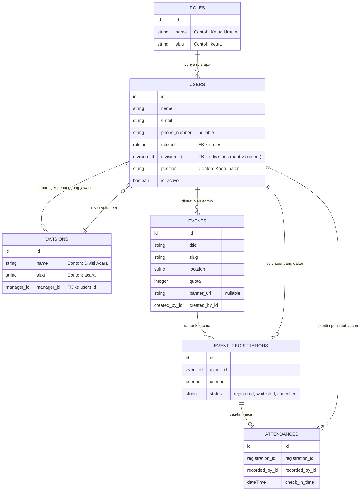

# refactor notes/ feat-fawwaz / 12 11 26

---

## 🧐 1. Kenapa Kemarin Database-nya Harus Dirombak?

Ada beberapa masalah di struktur awal yang bikin aplikasi gampang *crash*:
1. **Role Terlalu Kaku:** Kemarin role-nya di-lock mati pake `enum('admin', 'manager', 'volunteer')`. Begitu ada peran nyata kayak Ketua, Sekretaris, dan Bendahara, databasenya langsung nggak muat.
2. **Form Register Bikin Error Database:** Kolom `phone_number` dan `role` tadinya wajib diisi (`NOT NULL`), padahal form register bawaan belum minta input no HP. Pas ada orang daftar, langsung kena error SQL.
3. **Tabel Ada tapi Nggak Ada Modelnya:** Migrasi tabel `events`, pendaftaran event, dan absensi udah dibikin, tapi belum ada Model Eloquent-nya di folder `app/Models`. Model `User.php` juga belum kenal kolom-kolom barunya.
4. **Seeder Sering Crash:** Begitu di-seed, datanya nabrak karena urutan tabelnya belum pas.

---

## 👥 2. Struktur Role Baru & Pembagian Tugas (RBAC)

Sekarang kita bikin tabel `roles` dinamis dan tabel `divisions` terpisah biar rapi.

### 🎭 6 Role yang Sekarang Aktif:

| Role | Slug | Tugas & Hak Aksesnya |
| :--- | :--- | :--- |
| **Admin** | `admin` | **Bos Sistem:** Punya semua akses tanpa batas (*bypass* otomatis). Bisa atur user, ganti role orang, dan setting sistem. |
| **Ketua** | `ketua` | **Super Manager:** Bisa intip dan edit semua pekerjaan lintas divisi (Acara, Logistik, Humas, dll) biar gampang mantau tim. |
| **Sekretaris** | `sekretaris` | **Urusan Data & Berkas:** Megang verifikasi pendaftar, absensi event, dan ngawasin divisi yang dia pegang. |
| **Bendahara** | `bendahara` | **Urusan Cuan:** Khusus ngelola modul donasi, kas, dan logistik/kebutuhan barang event. |
| **Volunteer** | `volunteer` | **Relawan:** Masuk ke divisi tertentu, bisa daftar ikut event, dan mantau riwayat event sendiri. |
| **Pending** | `pending` | **Pendaftar Baru:** Siapapun yang baru register otomatis dapet role ini dulu, nunggu di-approve sama Admin. |

---

### 🤝 Alur Kerja Santai antar Manager (Shared Workflow):
* **Admin Otomatis Sakti:** Di Laravel ada `Gate::before`. Kalau rolenya `admin`, otomatis boleh ngapa-ngapain tanpa perlu kita daftarin izinnya satu-satu.
* **Ketua Bisa Masuk ke Semua Divisi:** Di model `User.php` udah ada method `canManageAllDivisions()`. Kalau dia Admin atau Ketua, dia otomatis dapet akses ke semua divisi.
* **Manager Membawahi Divisi:** Tabel `divisions` punya kolom `manager_id`. Jadi 1 manager bisa megang beberapa divisi volunteer sekaligus.

---

## 📊 3. Gambaran Relasi Tabel (ERD)

Biar gampang ngebayangin relasinya di kepala:



---

## 📂 4. File-File yang Udah Dibikinin / Dioprek

### A. Migrasi (Urutan Timestamp Udah Bener)
1. `...000000_create_roles_table.php` ➔ Bikin tabel `roles`.
2. `...000001_create_divisions_table.php` ➔ Bikin tabel `divisions`.
3. `...000002_create_users_table.php` ➔ Tabel `users` pake `role_id` & `division_id`, hapus enum lama, `phone_number` dibikin nullable biar aman.
4. `...000003_create_cache_table.php` & `000004_create_jobs_table.php` ➔ Urutan bawaan Laravel.
5. `...000005_add_manager_id_to_divisions_table.php` ➔ Nambahin kolom `manager_id` ke tabel divisi biar nggak bentrok foreign key.
6. `...create_events_table.php` ➔ Kolom `banner_url` dijadiin nullable (biar admin tetep bisa bikin event walau posternya belum jadi).

### B. Model Eloquent (Tinggal Panggil Relasinya)
* **`app/Models/Role.php`** ➔ Relasi `users()`.
* **`app/Models/Division.php`** ➔ Relasi `manager()` dan `volunteers()`.
* **`app/Models/User.php`** ➔ `$fillable` udah komplit. Udah ada relasi `role()`, `division()`, `managedDivisions()`, plus fungsi sakti:
  * `$user->hasRole('admin')` atau `$user->hasRole(['admin', 'ketua'])`
  * `$user->isManager()`
  * `$user->canManageAllDivisions()`
  * `$user->canManageDivision($divisionId)`
* **`app/Models/Event.php`** ➔ Relasi pembuat event & list pendaftar.
* **`app/Models/EventRegistration.php`** ➔ Relasi volunteer, event, dan absensinya.
* **`app/Models/Attendance.php`** ➔ Relasi catatan hadir peserta event.

### C. Seeder & Testing
* **`RoleSeeder.php`** ➔ Nyiapin 6 role dasar.
* **`DivisionSeeder.php`** ➔ Nyiapin 4 divisi awal: Acara, Logistik, Operasional, Humas.
* **`UserSeeder.php`** ➔ Nyiapin akun testing buat tiap role.
* **`EventSeeder.php`** ➔ Nyiapin 1 event dummy lengkap sama 1 volunteer yang udah kedaftar dan diabsen.
* **`UserFactory.php`** ➔ Udah diisi default `role_id` otomatis biar `php artisan test` nggak merah.
* **`RegisteredUserController.php`** ➔ Kalau ada akun baru register publik, otomatis dapet role `pending`.

---

## 🧪 5. Cara Ngetes di Komputer Masing-Masing

Jalankan perintah ini di terminal:

```powershell
php artisan migrate:fresh --seed
```
*(Kalau pake XAMPP custom port MySQL, pastiin port di `.env` sesuai sama XAMPP kalian, misal `3306` atau `3308`)*.

### 🔑 Akun Dummy Buat Coba Login
Semua akun passwordnya sama: **`password123`**

| Siapa | Email Login | Role di Database | Keterangan |
| :--- | :--- | :--- | :--- |
| **Admin** | `admin@gplyuk.com` | `admin` | Bos besar |
| **Ketua** | `ketua@gplyuk.com` | `ketua` | Megang kendali semua divisi |
| **Sekretaris** | `sekretaris@gplyuk.com` | `sekretaris` | Membawahi Divisi Acara & Humas |
| **Bendahara** | `bendahara@gplyuk.com` | `bendahara` | Membawahi Divisi Logistik |
| **Volunteer** | `volunteer@gplyuk.com` | `volunteer` | Relawan di Divisi Acara |
| **Pending** | `pending@gplyuk.com` | `pending` | Ceritanya baru daftar, nunggu approve |

---

## 🎯 6. PR Selanjutnya Buat Developer Backend

1. **Bikin Middleware `CheckRole`:**
   Tinggal bikin middleware yang ngecek `$request->user()->hasRole($roles)`. Kalau rolenya nggak cocok, lempar `abort(403)`.
2. **Daftarin di `bootstrap/app.php`:**
   Daftarin alias `'role' => \App\Http\Middleware\CheckRole::class`.
3. **Bungkus Rute di `routes/web.php`:**
   Tinggal pasang di rute, contoh:
   * Khusus Admin: `middleware(['auth', 'role:admin'])`
   * Manager / Pengurus: `middleware(['auth', 'role:admin,ketua,sekretaris,bendahara'])`
   * Volunteer: `middleware(['auth', 'role:volunteer'])`
4. **Oper Data Role ke Frontend (React):**
   Di `HandleInertiaRequests.php`, tinggal load `role` sama `division` di `auth.user` biar temen frontend bisa bikin menu/sidebar dinamis sesuai role yang login.
